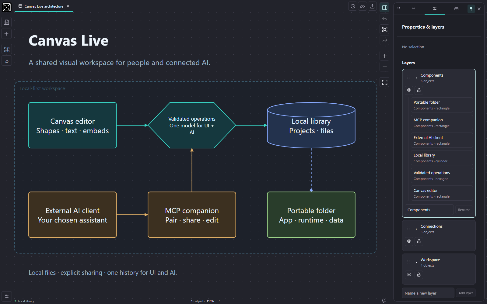

# Canvas Live

**A student-led, AI-assisted whiteboard for visual planning and explicit AI collaboration.**

**Vibe coded with OpenAI Codex.** I guide the ideas, requirements and interaction design, test the app, and refine it with Codex's help.

Canvas Live combines a TypeScript/SVG canvas editor, local project storage, a portable Windows launcher, and a Model Context Protocol (MCP) companion. A person can edit a board normally, share that specific canvas with an external AI client, and review or undo changes in the same editor.

This is a working student project under active development. The local editor and MCP protocol have been exercised together; the owner's current ChatGPT tunnel connection still needs end-to-end acceptance. Real-time multiplayer is future work.



The screenshot uses the [included sample canvas](examples/portfolio-demo.CLF), with generic project data. See the [demo walkthrough](examples/README.md) to reproduce it.

## What you can do

- Organize workspaces, nested projects and canvases, with explicit creation destinations, recoverable Trash, moves between workspaces and independent appearance settings.
- Edit shapes, text, areas and attached relationships. Drag either relationship endpoint to another object's side; blank drops keep its previous attachment. Use group selection, text formatting, snapping, expandable layers, layer dragging and Undo/Redo.
- Add images, GIFs, audio, video, websites and supported documents. Pause or minimize embeds; website interactivity depends on the provider's framing policy.
- Save and recover local work using individual native records and automatic project/workspace folders. Import/export validated `.CLF`, `.CLP` and `.CLW` files, and copy exact/latest local workspace links.
- Explicitly share canvases from separate views through 16 bounded MCP tools. Edits use the same validated operations as manual editing, and sharing continues on Home and Options.
- Customize an interactive AI mini from Options or Workspace AI. See recent activity and colored location indicators for AI reads, requested edits and acknowledged changes. Double-click the mini to open its panel. Client logos identify reported clients; activity reflects observed MCP events.
- Build a Windows package containing the local site, C# launchers and a verified Node runtime for the optional companion.

## Try it from source

Use **Node.js 24.x, version 24.15 or newer**, and npm. No model API key is needed to edit canvases or test the local MCP server.

```sh
git clone https://github.com/arbiesantinocastillo90-hub/Canvas-Live-Whiteboard.git
cd Canvas-Live-Whiteboard
npm ci
npm run dev
```

Open the loopback address printed by Vite, normally `http://127.0.0.1:5173`. On Windows PowerShell, use `npm.cmd` if the `npm.ps1` wrapper is blocked.

Create a project, choose its parent or **Workspace root**, then import [portfolio-demo.CLF](examples/portfolio-demo.CLF) from the canvas library. The app is useful without an AI connection.

For the optional companion, run `npm run mcp` in another terminal and follow [MCP setup](docs/CHATGPT_MCP.md). Browser pairing codes, MCP client tokens and OpenAI tunnel runtime keys serve different purposes. ChatGPT web needs its supported tunnel or a reachable HTTPS endpoint; a local loopback URL alone is insufficient.

### Portable Windows build

```powershell
npm.cmd run package:windows
```

Open `release/Canvas Live/Canvas Live.exe`; start `Canvas Live MCP.exe` for optional AI access. Keep the complete folder and its `data/` directory together. Node is bundled for the companion, and administrator installation normally isn't needed. School device policies may still restrict executable files or network connections.

There is currently no published binary release. The [portable guide](docs/PORTABLE_MCP.md) explains USB startup, saving, credentials and transport limits. A second physical computer has not yet been verified.

## Engineering highlights

| Problem                                                        | Design choice                                                         | Where to look                                                                     |
| -------------------------------------------------------------- | --------------------------------------------------------------------- | --------------------------------------------------------------------------------- |
| Manual and AI edits must obey the same rules                   | Validated canvas operations and shared history                        | [Operations](src/app/canvasOperations.ts), [commands](src/mcp/canvasCommands.ts)  |
| Camera navigation should not invalidate ordinary content edits | Separate content revisions while retaining conflict checks            | [Revisions](src/mcp/canvasRevision.ts), [bridge](server/bridge.ts)                |
| Retries must not duplicate edits                               | Stable IDs, operation IDs, atomic batches and browser acknowledgments | [Protocol tests](tests/mcp/companion.test.ts)                                     |
| AI access needs a clear boundary                               | Explicit sharing, separate credentials and bounded tools              | [Transport](server/http.ts), [browser bridge](src/app/useMcpBridge.ts)            |
| Local saves must handle failures                               | Draft recovery, explicit destinations and native optimistic revisions | [Recovery](src/app/canvasRecovery.ts), [native library](launcher/LocalLibrary.cs) |

Read the [case study](docs/CASE_STUDY.md) for the problem, tradeoffs and lessons, or the [architecture](docs/ARCHITECTURE.md) for component boundaries.

## Milestones and evidence

The [timeline](docs/TIMELINE.md) links real commits and retains their timezone offsets. The [roadmap](docs/ROADMAP.md) separates delivered behavior, remaining acceptance work and future scope. Dates describe evidence and commits, not estimated effort or retroactively assigned deadlines.

The October 21 AI presence revision passed **1,276 application tests**, **86 MCP protocol tests** and **13 isolated production browser scenarios**, including real activity locations, manual conflicts, customization and sharing isolation. See [presence verification](docs/AI_PRESENCE_VERIFICATION.md). The preceding [October 20 refinement](docs/BUGS_REFINEMENTS_VERIFICATION.md) separately records durable-library, recovery and native-storage checks; native code is unchanged in this revision. Focused runs overlap with full suites and are not added to their totals. See [testing instructions](docs/TESTING.md).

```sh
npm run check
npm run check:docs
```

GitHub Actions runs source/protocol checks and the build on Linux. Native checks require Windows and have separate commands and documented boundaries.

## Project ownership and AI assistance

This is a student portfolio project built through vibe coding with OpenAI Codex. Product direction, requirements, interaction feedback and acceptance decisions come from the project owner. Codex assists with implementation, debugging, tests and documentation. The repository presents AI-assisted engineering work; it does not claim every line was written manually.

The portfolio focuses on turning a product idea into testable behavior, inspecting failures, making tradeoffs and maintaining a development record. See [the development process](docs/CASE_STUDY.md#development-process-and-ai-assistance).

## Current boundaries

- The product is single-user with an explicitly shared AI editing session. Multiplayer and automatic concurrent document merging are not implemented.
- Current ChatGPT account/tunnel acceptance remains pending; a local SDK round trip is separate evidence.
- Portable builds target Windows x64 with the documented .NET requirements. Another physical computer and school compatibility remain unverified.
- Unsaved browser drafts, browser permissions and files saved outside the USB do not automatically travel with the package.
- Large-board performance and broader accessibility/device testing need further work. Existing bundle-size warnings remain documented.

[Documentation](docs/README.md) · [Contributing](CONTRIBUTING.md) · [Security](SECURITY.md) · [MIT license](LICENSE) · [Dependency notices](docs/LICENSES.md)
