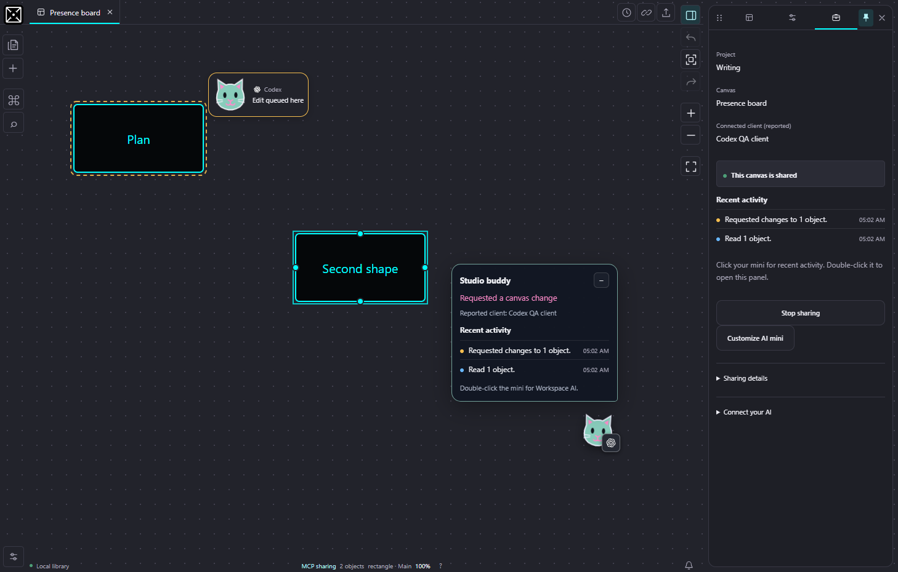
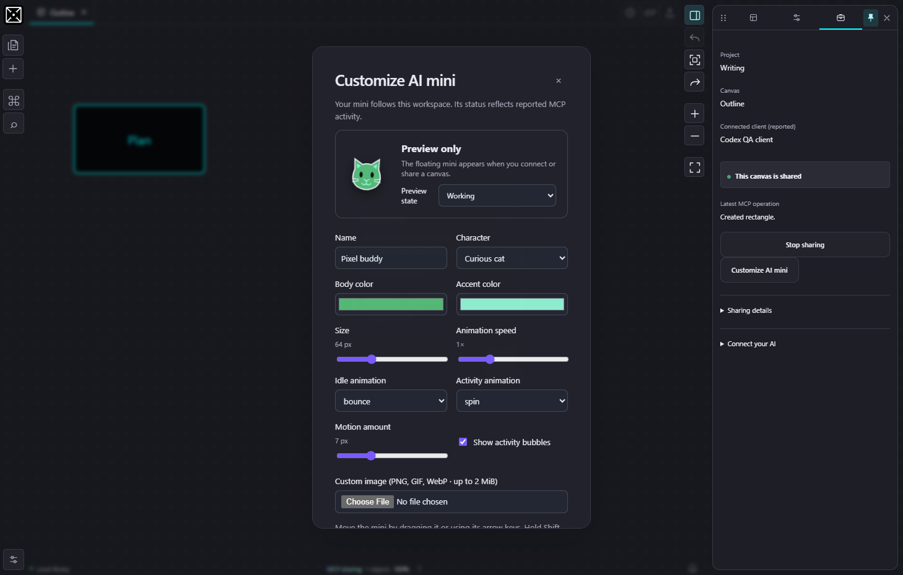

# AI mini and shared canvases

Workspace AI can display a small interactive companion while its canvas is connecting or shared. The mini represents that explicit MCP connection. It is an interface overlay, not an object added to the drawing or an AI model running inside Canvas Live.

Click the mini to open its recent-activity bubble. Double-click it to open Workspace AI; **Alt+Enter** does the same while the mini has keyboard focus. Drag it within the canvas pane, or move its focused control with the arrow keys. Minimize it to keep a smaller indicator. Sharing and customization controls live in Workspace AI, leaving the bubble for activity.

Open **Options → AI presence → Customize AI character and indicators** or **Customize AI mini** in Workspace AI to change settings, including before sharing. Both entry points edit the same workspace settings and stay synchronized in the current view.

The settings dialog includes a live appearance preview and an Idle/Working preview selector. It works before connecting, so you can see and customize the mini without an AI runtime key. The preview is labeled separately from actual connection activity; the floating mini appears while connecting or sharing.

Settings include a robot, cat or orb, a name, colors, size, speech bubbles, separate idle and working motions, speed and movement amount. A bounded PNG, GIF or WebP can replace the built-in mascot. Canvas indicators have their own read, requested-edit and completed-edit colors, pulse/ripple/static styles, duration and labels. Settings and image references belong to the workspace and use native storage when available. Reduced-motion preferences stop movement and avoid playing a custom animation.

The bubble shows up to five recent MCP activities, and Workspace AI shows up to twenty. A request is updated in place when its local edit is acknowledged. Repeated polls and acknowledgments do not create duplicate entries. These short-lived entries belong to the current sharing session; they are not exported with the canvas. Labels and operation summaries are displayed as literal text.

An animation indicates an observable MCP event, not a progress estimate or a representation of the model's private reasoning. A requested edit and a completed change have distinct states. If confirmation is lost, the history reports an unconfirmed request rather than claiming that an edit succeeded.

## Activity locations on the canvas

With **Show activity on canvas** enabled, targeted reads and edits briefly highlight the actual affected objects and display the same character beside them. Pan and zoom keep indicators aligned with the drawing. A move can show its former position; an acknowledged deletion can briefly mark the deleted object's former bounds. An offscreen cue points toward work outside the current view without moving your camera.

- **Read here** means an MCP read returned that object. Listing available shared canvases does not highlight every board.
- **Edit queued here** means a validated request is waiting for the local editor. Fast edits may proceed directly to the completed state between polls.
- **Edited here** or **Removed here** follows a successful local acknowledgment. New automatically generated objects get locations after their actual IDs and geometry exist.

Hidden objects are excluded from location indicators. The overlay does not select objects, change the camera, add canvas elements or create Undo steps. Its character opens Workspace AI on double-click or Enter/Space. Stop sharing or switch the current canvas/project/workspace to clear that session's activity. Each explicitly shared view keeps its own locations and history.

Indicators expire after the configured two to fifteen seconds, measured from the event rather than the latest poll. A maximum of 32 targets is rendered per event, with up to 100 target IDs accepted from the companion. The activity log retains at most twenty entries. These bounds limit UI work; they are not large-board performance measurements.

Both application and operating-system reduced-motion settings keep location cues static and replace animated raster characters with the built-in robot. You can also disable location animation or hide location labels independently. See the [dated presence verification](AI_PRESENCE_VERIFICATION.md) for tested behavior and remaining acceptance.

This disposable SDK test canvas shows an authentic queued request with controlled command delivery, not an external model's thinking time. Its selection and camera remain under the user's control.

Client branding comes from the authenticated MCP client's reported name. It identifies that client, not its underlying model or subscription. Unknown clients retain a neutral badge and their reported name. Provider marks remain separate from the customizable mascot.

The static badges use unaltered official OpenAI artwork for OpenAI, ChatGPT and Codex, plus the corresponding official Claude and Anthropic marks. Other client badges use text until an official asset is bundled. The marks never inherit the mascot's colors or animation. See the bundled [trademark and source notices](../public/assets/ai-clients/NOTICE.txt); these client marks are not covered by the project's MIT license or a claim of provider endorsement.

Custom image uploads are checked against their raster file signatures and limited to 2 MiB. Both the app and operating system reduced-motion options replace custom images with a static robot, preventing animated GIF, WebP and PNG playback. A failed portable settings write retains the current appearance and browser cache and reports an error. Escape, pointer cancellation, lost capture or window focus loss cancels a drag without persisting its preview position. Changes do not enter the canvas Undo history.

This screenshot uses a disposable test canvas and a local SDK client. It demonstrates the interface, not acceptance through a cloud AI account.

## Sharing more than one canvas

Open another Canvas Live view, choose its canvas and explicitly share it there. The companion supports up to 16 independent grants. Each has its own session, document revisions, pending operation, retry history and revocation. Two views cannot take ownership of the same canonical canvas at once.

An MCP client calls `list_shared_canvases`, chooses the intended `sessionId`, then calls `get_canvas_state` with it. With several grants, an untargeted read asks the client to select a canvas rather than guessing. An operation never inherits authorization or a revision from a different canvas.

Sharing continues when a view opens Home or Options. Manual commands stay disabled on that hidden editor; explicitly shared AI commands use its retained document and Undo history. Stop sharing, switching that view's file/project/workspace, closing the view, or an expired heartbeat ends the grant. Closing the AI panel alone does not.

Local MCP and browser tests verify this behavior locally. They do not establish acceptance through a particular cloud account or tunnel. See [MCP setup](CHATGPT_MCP.md).
