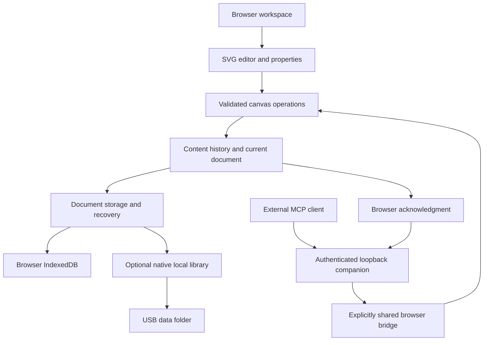

# Architecture

Current implementation as of October 19, 2026. Canvas Live is a single-user, local-first React/TypeScript application with an optional MCP companion. Manual and AI edits use the same validated document operations. Real-time multi-user collaboration is future work.

## Application and document model

`App.tsx` owns Home, Work, Options and named workspaces. `HomePage.tsx` and `ProjectHierarchy.tsx` display projects belonging to the active workspace. Creation requires a destination project; projects may also be created at the workspace root. This is a logical parent choice, separate from physical file saving. Workspace membership and presentation metadata are separated so changing one workspace's cards does not restyle another's.

`FileWorkspace.tsx` owns project files, tabs, saving and dock context. Home and Options retain the mounted editor and its history while making manual controls inert. An explicitly shared connection can continue using the retained controller there; stopping sharing or unmounting revokes background command permission. Switching documents or projects starts a new content history and ends that view's grant. Closing a tab does not delete its file.

`lcanvas.ts` validates the LCANVAS v2 payload and migrates supported v1 documents in memory. Stable identifiers link objects, connections and layers. Documents are bounded to 10 MiB, 5,000 elements and 100 layers; coordinates, references, colors and optional fields are validated. `.CLF`, `.CLP` and `.CLW` serve different document, project and workspace purposes; see [File formats](FILE_FORMATS.md).

`CanvasEditor.tsx`, `RichObject.tsx` and `EmbedObject.tsx` render original SVG geometry, literal text and bounded media views. `CanvasInspector.tsx` and the quick properties panel edit the same document model. No third-party drawing engine is installed. The early Excalidraw evaluation is historical; it is not a prerequisite for this implemented editor.

## Operations, gestures and history

`canvasOperations.ts` contains pure document operations for creating, updating, moving, resizing, deleting and connecting elements and managing layers. Invalid geometry, references or lock violations reject the transaction. UI gestures and `src/mcp/canvasCommands.ts` reuse these operations rather than maintaining separate business logic.

Side handles start attached connections; transparent edge targets resize objects. Areas have border-only pointer and marquee selection. Layer order determines stacking, with areas below other objects in the same layer. The Inspector combines expandable layers and their objects, using validated operations for layer reordering and cross-layer object moves. The containing-area selector has been removed; supported older documents retain their explicit membership semantics.

`editorHistory.ts` records completed content transactions. Navigation updates the current camera without consuming Undo/Redo. A completed group drag or atomic AI batch is one history step. History retains at most 100 prior snapshots within an estimated 32 MiB budget; large documents retain fewer steps. Camera updates are batched to animation frames. History is session state, excluded from portable files.

## Persistence and recovery

The development/browser-only app uses project-indexed IndexedDB documents and validated local metadata. The packaged app uses `LocalLibrary.cs` and `localLibrary.ts` for individual atomic records in `data/library-v2/`, with project/workspace folders and previous-copy recovery. A staged conversion retains the earlier `library.json` and its backup. A lightweight catalog permits project browsing without downloading every drawing; bodies load by project and are cached by revision. Browser profiles connected to that package share its native library even when its loopback port changes. Browser-only storage remains specific to its profile and origin. See [local folders and recovery](DURABLE_LIBRARY.md).

Native writes require an `If-Match` record revision; stale writes receive a conflict instead of silently replacing newer content. `librarySync.ts` merges locally changed metadata fields with the current stored metadata. These are optimistic save safeguards, not real-time multiplayer or automatic merging of concurrent canvas edits.

`canvasRecovery.ts` retains dirty snapshots without overwriting newer explicit saves. `canvasLocalFiles.ts` stores user-selected native file handles separately and acknowledges writes after stream close. Bound autosaving uses already granted permission. When an embedded view blocks external writes, a successful owned-library recovery commit is reported separately and the external baseline remains pending. Draft recovery, native-library saving, physical Save/Save as and portable Export are distinct paths; see [Save options](SAVE_OPTIONS.md).

`workspaceTrash.ts` stores bounded workspace-local removal references, retaining canonical projects and files for restoration. Project moves change membership; file moves persist a destination record before hiding the source reference. Dirty drafts, ownership and destination checks prevent an action from silently discarding open work.

`canvasMedia.ts` validates supported local media up to 20 MiB, stores binary data separately and references it by content hash. The native package keeps it in `data/media/`; appearance assets live in `data/appearance/`. Paused or minimized embeds unload players/frames. Website frames are sandboxed and subject to the provider's framing and authentication rules. An exported media reference does not contain the media bytes: portable backups must include the relevant data folder.

Named UI sessions, layout, backgrounds and exact/latest view links reference documents without granting AI access or carrying credentials. Browser permissions and unsaved drafts do not automatically transfer to another computer.

## Workspace controls

`DockPanel.tsx` centralizes pinning, transient closure, roving tab keys and bounded resizing. `PanelResizeHandle.tsx` supports pointer and keyboard adjustment on side, top and bottom edges. Pinned docks reserve space on wide screens; unpinned or narrow-screen docks overlay the canvas. Hidden content stays mounted and inert so property drafts survive panel changes. `layout.ts` persists bounded choices separately from document content.

`WorkspaceCommands.tsx` and `shortcuts.ts` route commands to the same UI handlers while protecting text inputs, composition and dialogs. Appearance uses shared CSS tokens and system fonts. App and operating-system reduced-motion preferences override animation.

## Portable Windows host

`CanvasLiveLauncher.cs` is a .NET Framework GUI host for the packaged website and narrowly scoped native library/media endpoints. It binds only to loopback, checks Host, paths, methods and request bounds, and serves an exact static-file whitelist. A per-user, per-folder mutex and health endpoint support instance reuse. Port 4173 is preferred; an occupied port selects an available loopback port.

`CanvasLiveMcpLauncher.cs` separately supervises the companion, discovers or starts its matching app host and stops only its owned Node child. The package includes an official pinned Node.js 24.15.0 Windows x64 runtime; no global Node installation is needed to run it. `package-mcp-runtime.ps1` checks archive/executable hashes and the OpenJS signature and includes provenance and complete runtime notices. The optional USB-root entry resolves the package through a relative path. See [Windows launcher](WINDOWS_LAUNCHER.md) and [Portable MCP](PORTABLE_MCP.md).

## MCP authority and synchronization

`server/http.ts` exposes authenticated Streamable HTTP with distinct random credentials for MCP access and browser pairing, exact Host/origin checks, bounded requests and rate limits. `server/tools.ts` registers 16 tools, including `list_shared_canvases`. Reads return at most 100 objects, batches contain at most 25 operations, and cumulative deletion is limited to 10 objects. No unrestricted filesystem, shell, browser, save/export or unshared-document tools are exposed.

The native discovery endpoint returns only its matching companion's address and browser pairing credential; the separate MCP access token is not returned to the browser. Sharing still requires an explicit **Share this canvas** action. Client identity is reported from the authenticated MCP initialization message; it does not establish which model is running.

`useMcpBridge.ts` publishes committed state through sequential 500 ms polls. Each browser view owns one explicitly shared file; the companion supports up to 16 independent grants with separate pending transactions and retry histories. An untargeted read is rejected when several canvases are shared. Writes carry session, revision and operation identifiers, are validated again by the editor and succeed only after browser acknowledgment. Active gestures reject edits; identical retries do not duplicate mutations. Expiring commands and revision checks reject late or stale writes. Each session permits 128 logical operations before renewal.

Content stamps exclude the viewport so completed camera navigation does not invalidate an otherwise current ordinary edit. Actual content changes invalidate older writes; Undo/Redo retain exact revision checks. Switching files/projects/workspaces, Stop sharing, closing the view or a lost heartbeat revokes authority. Home, Options and hiding the AI panel do not. Sharing includes unsaved content in that document; successful edits use the same history and save controls as manual edits.

`CanvasAiMini.tsx` is a draggable UI overlay driven by reported client identity and observed read/edit activity. Its validated, workspace-scoped settings use ordinary library settings records; custom images use the existing appearance asset store. The mascot supports reduced motion and has no ability to execute arbitrary animation code. See [AI mini and sharing](AI_MINI.md).

Local SDK and browser checks establish the local integration, not an external account's approval or live cloud editing. Cloud clients need their supported tunnel/HTTPS transport; Canvas Live does not call a model inference API. See [ChatGPT setup](CHATGPT_MCP.md), [MCP verification](MCP_VERIFICATION.md) and [current workspace verification](WORKSPACE_INTERACTIONS_VERIFICATION.md).
