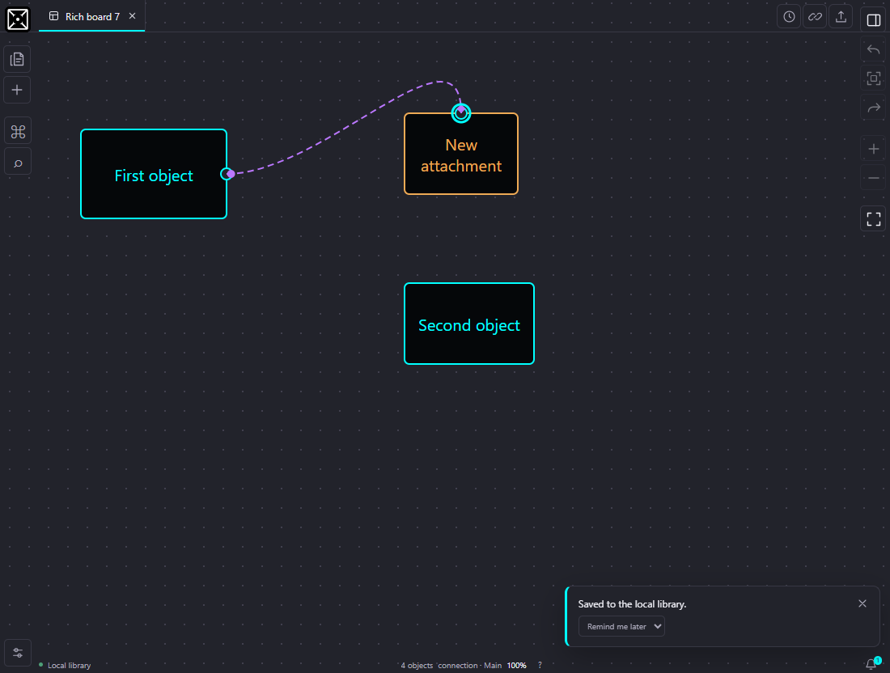

# Relationship endpoint verification

Record prepared on October 19, 2026. This update lets a user reconnect either end of an existing relationship without deleting it or changing the document schema. See [Editor controls](EDITOR.md#connections) for the user workflow.

## Acceptance behavior

- Selecting an editable relationship exposes two circular handles, one at each endpoint. Ordinary shape resize and connection-creation controls retain their existing roles.
- Dragging either end previews the existing path, line pattern and pointers. A valid target highlights its nearest Top, Right, Bottom or Left side. A different side of the current object is also a valid destination. Area targets accept their borders only.
- Dropping on an editable target replaces only the dragged attachment and its side. The relationship keeps its ID, opposite attachment, appearance and current camera. Moving or resizing the newly attached object continues to update the relationship.
- A successful drop creates one content-history step. One Undo restores the previous attachment, and Redo reapplies the change without moving the camera.
- Blank space, unavailable targets and the opposite endpoint's object leave the relationship unchanged. No detached endpoint is saved. An unchanged drop or a click without dragging also creates no history step; this includes existing Auto attachments.
- Escape, pointer cancellation, lost pointer capture, focus loss, leaving Work and replacing the active file discard the temporary preview. No preview object enters the controller document, history, export or persisted canvas.

Hidden or locked layers and existing area-membership restrictions remain enforced. If reconnecting makes a connection's legacy explicit area membership invalid, the operation clears that connection's membership; unrelated objects retain their membership. Layer organization and the removed Containing area selector are unchanged.

## Automated evidence

The focused operation report passed **79 / 79 tests**, including 22 cases in the new reconnection operation file and existing operation/rich-canvas cases. The focused editor report passed **72 / 72 tests**, including 33 reconnection UI cases and existing area, rich-interaction, backdrop and camera cases. Both reports have zero failures or pending tests. These focused runs overlap the complete application suite and must not be added to its total.

Source evidence:

- [Validated attachment operation](../src/app/canvasOperations.ts) and [operation regressions](../src/app/canvasOperations.reconnect.test.ts): both endpoints and four sides, unchanged references, invalid and protected targets, legacy membership, serialization, movement/resizing, one-step Undo/Redo and retained Auto support.
- [Editor gesture implementation](../src/app/CanvasEditor.tsx) and [editor regressions](../src/app/CanvasEditor.reconnect.test.tsx): exactly two handles, nearest-side detection, live appearance, transformed camera coordinates, supported shapes, blank drops, click-only Auto attachments, cancellation paths, protected targets, area borders and the panel-gap backdrop.
- [Existing document format](FILE_FORMATS.md): LCANVAS v2 still stores connections using object IDs and attachment sides. This change adds no free-coordinate endpoint fields or migration.

The complete suite passed against the final source. The publication checkout and browser staging build produced identical index hashes, JavaScript and stylesheet assets.

| Final integration check                     | Result                                                                            |
| ------------------------------------------- | --------------------------------------------------------------------------------- |
| Complete application suite                  | 1,096 passed; 181 suites; zero failures or pending                                |
| MCP protocol suite                          | 64 passed; zero failures or pending                                               |
| TypeScript, lint and formatting             | Passed, including whole-repository formatting                                     |
| Production build and license review         | Passed; 232 license records; existing bundle-size and dependency comment warnings |
| Isolated browser endpoint scenarios         | 21 passed; zero JavaScript page errors                                            |
| Production JavaScript asset                 | `index-fFeJ-NfV.js`                                                               |
| Production stylesheet asset                 | `index-BtjgbN4a.css`                                                              |
| Raw production index SHA256                 | `3CEBE99C50B1101C3D7FD1306E520A229B5FB4AA996B9FA35C5D9CB7AC8D5D36`                |
| Installed asset and data-preservation check | Passed; 201 protected files and 31 existing assets unchanged                      |

The installed native host serves the verified JavaScript and stylesheet. Its storage-marker injection produces served index SHA256 `5221174B419A20DA392122284BDCF483E20635A313AE831C2F6D0E57E48EC996`. The frontend-only update preserved all 201 protected files, including existing native/MCP binaries, private configuration, library and media, plus all 31 previous hashed browser assets. The owner's browser was not refreshed or driven during installation.

## Production browser checks

The isolated native package and disposable Chrome contexts exercised both endpoints on all four sides, preserved styles and camera, one-step Undo/Redo, blank and unavailable drops, Escape, actual lost pointer capture, stationary Auto clicks, side changes on the current shape, locked relationships, area borders, zoom at 0.5 and 1.3, and native Save followed by reopening in a fresh context. The browser report contains 21 passing scenarios and no JavaScript page errors. Seven local-library requests were aborted during disposable context closure; these did not produce page exceptions or failed assertions.

## Isolation and limits

Implementation and focused tests use a staging copy and synthetic documents. Production browser verification must use its own native data directory and disposable browser context. The owner's active browser, canvas, clipboard, local-file permissions and AI-sharing session are outside the test fixture. Installation evidence must identify the actual served assets and preservation of the existing portable library, media and configuration.

Reconnection is an editor interaction; it does not add real-time multiplayer or a new MCP tool. A local MCP protocol result does not verify the owner's external ChatGPT account or tunnel. USB acceptance on a second physical Windows computer remains a separate milestone. Earlier [October 18 interaction](WORKSPACE_INTERACTIONS_VERIFICATION.md) and [rich-canvas](RICH_CANVAS_VERIFICATION.md) records retain their original dates and build identities.
